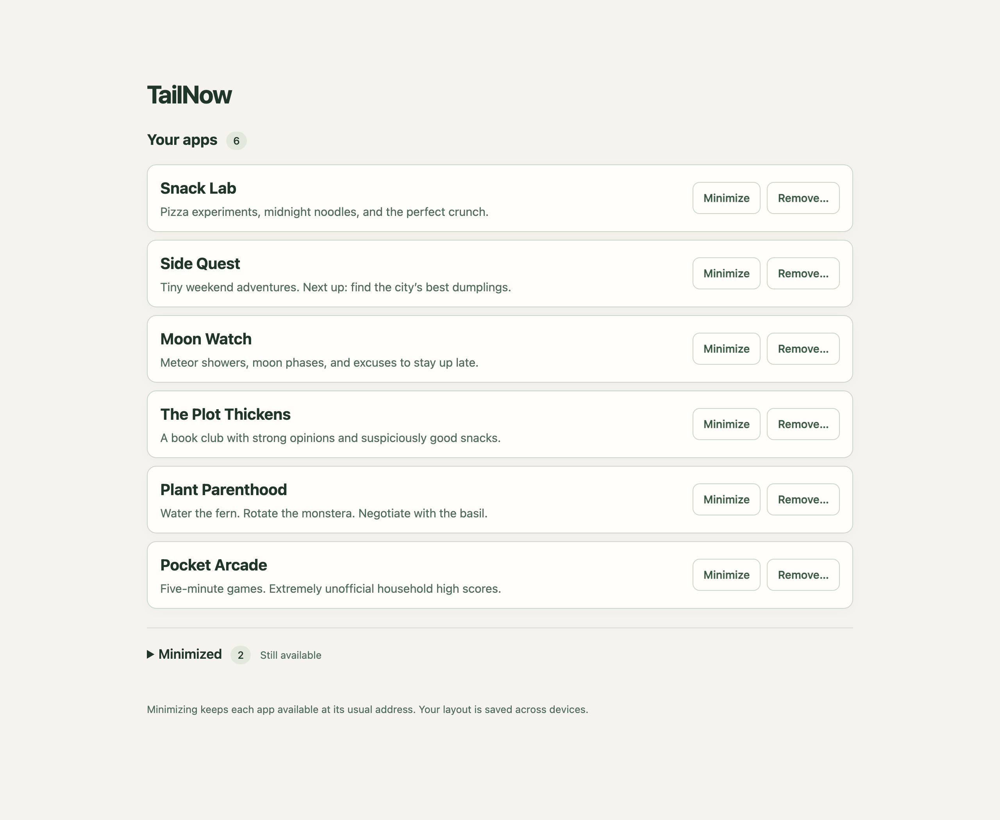

# TailNow

TailNow is a private home for your web apps. Publish static websites, add links to other apps, and find them all in one directory on your Tailscale network. Open it from your connected devices, then reorder, minimize, or restore apps to keep things tidy.

[](docs/images/tailnow-demo.png)

## Before you start

- **Tailscale:** [Download Tailscale](https://tailscale.com/download), create an account, and sign in on the computer running TailNow and each device you want to access it from. Keep the host computer awake and connected.
- **Claude Code or Codex:** Run your coding agent on the computer where you want to install TailNow.
- **Git and Node.js:** TailNow requires patched Node **24.22.3 or newer within the 24.x series**, with npm. The prompt below asks your agent to check and install these tools if needed.

Existing installations: follow the [security migration guide](docs/security-migration.md) before upgrading to v3. Each hosted app now needs its own HTTPS origin, and management requires administrator sign-in.

## Install and run

**Copy and paste this prompt into Claude Code or Codex:**

```text
Install and run TailNow on this computer from https://github.com/palpen/tailnow.git.

1. Check that Git, Node.js >=24.22.3 <25, and npm are installed. Install any
   missing tools using a suitable method for my operating system. Check that
   Tailscale is installed, signed in, and connected; guide me through any
   sign-in or account settings that require my action.
2. Clone the repository into a suitable local folder, enter it, read its setup
   and security instructions, and run npm ci --ignore-scripts. Preserve any existing installation.
3. Create tailnow.json from tailnow.example.json. Detect this computer's actual
   Tailscale DNS name and use a fresh HTTPS port, such as 8446, for baseUrl.
   Include that hostname:port in allowedHosts. Assign a distinct siteOrigins
   HTTPS port to each hosted app, such as 8500 onward. Use separate
   absolute paths for sitesDirectory and dataDirectory outside the checkout,
   with private data outside the served sites directory. Keep a valid
   serviceLabel and set apps to [] to remove the example app. Do not overwrite
   existing configuration or data.
4. Start TailNow with npm start on 127.0.0.1:8080. Inspect tailscale serve status,
   then forward the admin HTTPS port and each app HTTPS port to that local address.
   Preserve existing routes and services; if the address or port is in use,
   resolve the conflict with me. Help me enable Tailscale HTTPS if needed.
   Keep access private to Tailscale; do not enable Funnel or public forwarding.
5. Verify /api/health using the configured admin Host, locally and through HTTPS.
   Check the directory, each hosted app, and rejection of unauthenticated changes.
   Tell me how to retrieve the owner-only administrator key using scripts/admin-key.js
   and sign in. Do not put the key in URLs, logs, chat, or committed files.
   Leave TailNow running, give me the URL to open
   on my connected devices, and explain how to stop and restart it. Tell me
   whether it will restart automatically after a reboot.
```

Anyone your Tailscale access rules allow to reach TailNow can view its apps. Only someone with the administrator key can publish or manage them. Apps use separate browser origins. See [SECURITY.md](SECURITY.md) for the boundaries, including cookie-based external services.

## Publish a website

Assign the app a unique `siteOrigins` entry and forward its HTTPS port with Tailscale Serve first. Create a ZIP with `index.html` at its root, then publish from the server account:

```sh
TAILNOW_CONFIG=/absolute/path/to/tailnow.json node scripts/publish.js my-app site.zip
```

The publisher reads the private administrator key without putting it in shell arguments. The authenticated multipart API remains available at the admin origin's `/api/publish/my-app` endpoint. Your website appears in the directory immediately. Upload to the same name to update it. TailNow hosts static HTML, CSS, and JavaScript; apps that need their own server can be added as links in the configuration’s `apps` list.

**Remove** hides an app from the directory but leaves a hosted website accessible at its full URL. **Also shut down** takes a hosted website offline while retaining its files. Shutting down a linked app requires a configured, dedicated macOS LaunchAgent.

## Try the demo

From the cloned repository, with the required Node version installed:

```sh
npm ci
npm run demo
```

Open the loopback address printed by the demo. It uses temporary data and example links, prints the path to its sign-in key, resets on each launch, and leaves your private configuration untouched. Stop it with Ctrl+C.

## Development

```sh
npm test
npm audit
```

Browser tests use installed Google Chrome on macOS or Chromium from `node node_modules/playwright-core/cli.js install chromium`. CI installs Chromium and requires those tests. Use `PLAYWRIGHT_CHROMIUM_EXECUTABLE` for another executable.

Keep private storage backed up and run only one TailNow process per data directory. Storage quotas and release retention are configurable; see [SECURITY.md](SECURITY.md). For automatic startup on macOS, adapt the [LaunchAgent example](deploy/com.example.tailnow.plist.example), using a patched Node binary.

## License

Original code and documentation by Palermo Penano are covered by the [MIT License](LICENSE). See [LICENSING.md](LICENSING.md) for third-party and user-content scope.
